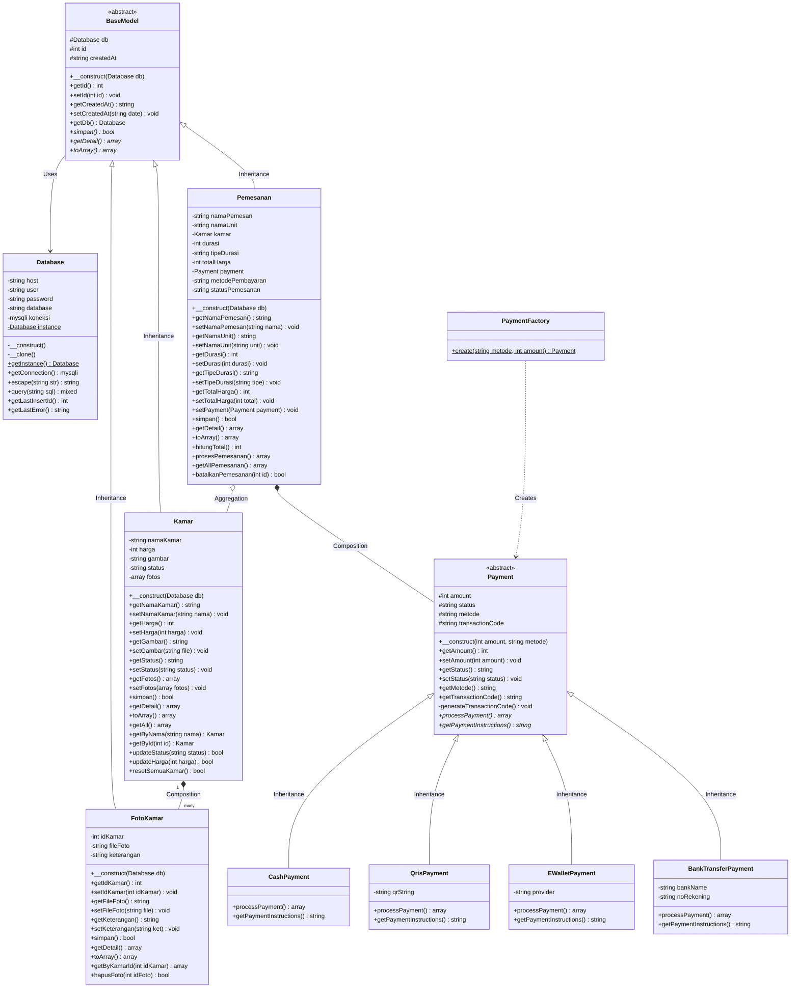

# Sistem Pemesanan & Pengelolaan Kost Online Berbasis OOP (PBO)

> **Ujian Tengah Semester (UTS) — Pemrograman Berorientasi Objek (PBO)**  
> **Program Studi:** Informatika | **Semester:** 3 (Tiga)  
> **Dosen Pengampu:** Fathulloh, ST, M.Kom  
> **Sifat Ujian:** Take Home  

---

## 📌 1. Judul dan Informasi Mahasiswa

* **Nama Anggota Kelompok & NIM:**
  1. **Rio Permana** — NIM: **42425030**
  2. **Muamar Renji Kordawi** — NIM: **42425031**
  3. **Alinda Restu Desiyana** — NIM: **42425021**
* **Kelas:** Informatika — Semester 3 (Tiga)
* **Mata Kuliah:** Pemrograman Berorientasi Objek (PBO)
* **Dosen Pengampu:** Fathulloh, ST, M.Kom
* **Tema Aplikasi:** **Sistem Pemesanan & Pengelolaan Kost Online** *(Kategori: dll / Sistem Pemesanan & Manajemen Properti Sewa)*

---

## 📖 2. Deskripsi Ringkas Aplikasi

### Latar Belakang
Proses pencarian dan reservasi kamar kost umumnya masih dilakukan secara konvensional atau pencatatan manual yang rentan kesalahan. Calon penyewa kerap kesulitan mengetahui ketersediaan kamar secara *real-time*, tidak memiliki fleksibilitas durasi sewa (harian maupun bulanan), serta tidak tersedianya bukti pemesanan yang transparan dan terintegrasi langsung dengan konfirmasi pengelola.

### Kegunaan Aplikasi
Aplikasi **Sistem Kost Online** ini dirancang untuk mendigitalkan seluruh proses reservasi dan administrasi kamar kost:
1. **Bagi Calon Penghuni Kost:** Memudahkan eksplorasi unit kamar dengan tampilan editorial butik dan galeri foto interaktif (*multi-slide carousel*), mengecek status ketersediaan secara instan (*Tersedia / Terisi*), memilih durasi sewa fleksibel (**Harian** atau **Bulanan**), melakukan booking dengan formulir terpisah yang praktis, serta memilih metode pembayaran multi-channel (QRIS, E-Wallet, Tunai/Cash) yang terhubung langsung ke WhatsApp pemilik kost.
2. **Bagi Pengelola/Pemilik Kost:** Mempermudah monitoring okupansi unit kamar, penyesuaian tarif/harga sewa, manajemen album foto sudut ruangan, serta pencatatan transaksi masuk melalui Dashboard Pengelola terintegrasi yang diamankan dengan autentikasi PIN.

---

## 🧱 3. Penerapan Konsep Pemrograman Berorientasi Objek (OOP)

Seluruh logika bisnis pada lapisan backend PHP dibangun murni dengan menerapkan 4 pilar dasar OOP:

### A. Class & Object
* **Representasi Entitas Nyata:** Sistem dimodelkan ke dalam class-class terpisah dengan tanggung jawab tunggal (*Single Responsibility Principle*):
  * `Database`: Blueprint pengelola koneksi database MySQL menggunakan *Singleton Pattern*.
  * `Kamar`: Entitas unit kamar kost, tarif, status ketersediaan, dan relasi galeri foto.
  * `FotoKamar`: Entitas album foto sudut ruangan (multi-slide viewer).
  * `Pemesanan`: Entitas transaksi reservasi penyewa kost.
  * `Payment`: Entitas abstrak pengolahan pembayaran.
* **Instansiasi Objek Dinamis:** Objek dibuat saat menangani request API, misalnya:  
  `$pemesanan = new Pemesanan($db);`  
  `$payment = PaymentFactory::create($metode, $totalHarga);`

### B. Encapsulation (Enkapsulasi)
* Seluruh atribut penting pada class dideklarasikan dengan tingkat akses `private` atau `protected` untuk melindungi integritas data (*data hiding*):
  * `Pemesanan::$namaPemesan` (private): Setter memvalidasi bahwa nama pemesan tidak boleh berupa string kosong/hanya spasi.
  * `Pemesanan::$durasi` (private): Setter memvalidasi durasi sewa minimal bernilai 1.
  * `Pemesanan::$tipeDurasi` (private): Setter membatasi pilihan hanya `'harian'` atau `'bulanan'`.
  * `Kamar::$harga` (private): Setter memastikan tarif kamar tidak boleh bernilai negatif.
  * `Database::$instance` (private static): Konstruktor dibuat privat agar instance MySQL hanya dapat diinisialisasi melalui method `getInstance()` (*mencegah duplikasi koneksi*).

### C. Inheritance (Pewarisan)
* **Superclass Abstrak `BaseModel` (`models/BaseModel.php`):**  
  Menyediakan properti dasar (`protected $db`, `protected $id`, `protected $createdAt`) dan metode dasar.
  * Diturunkan (*extends*) oleh subclass:
    * `class Kamar extends BaseModel`
    * `class FotoKamar extends BaseModel`
    * `class Pemesanan extends BaseModel`
* **Superclass Abstrak `Payment` (`models/Payment.php`):**  
  Menyediakan kerangka pemrosesan pembayaran (`amount`, `status`, `transactionCode`).
  * Diturunkan (*extends*) oleh subclass spesifik:
    * `class CashPayment extends Payment`
    * `class QrisPayment extends Payment`
    * `class EWalletPayment extends Payment`
    * `class BankTransferPayment extends Payment`

### D. Polymorphism (Polimorfisme)
* **Method Overriding pada Model (`BaseModel`):**  
  Class `BaseModel` menetapkan metode abstract:
  * `abstract public function simpan(): bool;`
  * `abstract public function getDetail(): array;`
  * `abstract public function toArray(): array;`  
  Masing-masing subclass (`Kamar`, `Pemesanan`, `FotoKamar`) meng-override dan mengimplementasikan logika penyimpanan serta serialisasi data yang unik sesuai entitasnya.
* **Polimorfisme Pemrosesan Pembayaran (`Payment`):**  
  Setiap turunan `Payment` meng-override method `processPayment()` dan `getPaymentInstructions()`:
  * `QrisPayment`: Menghasilkan instruksi scan QR code instan dan tautan gateway.
  * `EWalletPayment`: Menghasilkan instruksi transfer dompet digital (GoPay, OVO, DANA, ShopeePay).
  * `CashPayment`: Menghasilkan instruksi pembayaran tunai di tempat saat serah terima kunci kost.
  * Pembuatan objek dilakukan secara polimorfik melalui `PaymentFactory::create($metode, $amount)`.

---

## 📊 Class Diagram (UML)



---

## 🚀 4. Alur & Fitur Utama Program

### Alur Kerja Pengguna (User Flow)
```
1. Akses Website ────────► Hero Section Editorial & Tinjauan Unit Kamar
          │
          ▼
2. Klik Kartu Kamar ─────► Modal Interaktif Slider Foto Berbagai Sudut Ruangan
          │
          ▼ (Klik tombol "BOOK NOW" atau "Pilih Unit Ini")
3. Modal Form Pemesanan Muncul (Langkah 1)
   ├── Unit kamar langsung terpilih otomatis
   ├── Pilih Tipe Durasi Sewa: Harian (🌙) atau Bulanan (📅)
   ├── Atur Durasi (+ / -) dengan kalkulasi tarif proporsional otomatis
   ├── Input Nama Lengkap Pemesan
   └── Klik "Lanjut ke Pembayaran"
          │
          ▼
4. Modal Pilihan Metode Pembayaran (Langkah 2)
   ├── Pilih: E-Wallet / QRIS / Tunai (Cash)
   └── Backend OOP memvalidasi, menyimpan ke database MySQL, & mengupdate status kamar
          │
          ▼
5. Popup Sukses Booking
   └── Struk digital terbit + Tombol konfirmasi otomatis ke WhatsApp Pengelola Kost
```

### Daftar Fitur Utama:
1. **Desain Editorial Butik Properti:** Tampilan web responsif dengan tipografi klasik *Fraunces* dan *DM Sans*, palet hangat (*Warm Cream, Terracotta, Deep Brown*), bebas dari kesan template kaku.
2. **Katalog Unit Kamar Dinamis:** Menampilkan kartu kamar lengkap dengan overlay harga, indikator ketersediaan, spesifikasi kapasitas tamu, kamar mandi, dan dimensi luas ruangan.
3. **Interactive Photo Slider (Touch & Swipe):** Galeri sudut ruangan per unit kamar yang mendukung *swipe* pada layar sentuh ponsel, *drag* mouse, dan tombol navigasi panah.
4. **Pemisahan Formulir Pemesanan:** Halaman depan bersih dan fokus menampilkan unit; form pemesanan muncul dalam bentuk modal popup saat pemesan siap bertransaksi.
5. **Fleksibilitas Durasi Sewa (Harian & Bulanan):** Fitur pemesanan harian (tarif dihitung otomatis proporsional terhadap harga bulanan) maupun bulanan.
6. **Multi-Metode Pembayaran Polimorfik:** Dukungan metode bayar QRIS, E-Wallet, dan Cash dengan generator kode pembayaran instan.
7. **Integrasi WhatsApp Direct Confirmation:** Penyewa dapat langsung mengirimkan bukti konfirmasi booking ke nomor pengelola kost dengan format teks otomatis.
8. **Dashboard Pengelola (Admin) Terproteksi PIN:** Fitur manajemen status kamar, pengubahan harga, riwayat booking, dan upload foto kamar (PIN default: `1234`).

---

## 💻 5. Cara Menjalankan Program (How to Run)

### Prasyarat Sistem:
* Web Server Apache & PHP (PHP 7.4 / PHP 8.x) — direkomendasikan menggunakan **XAMPP**.
* Database MySQL / MariaDB.
* Web Browser modern (Google Chrome, Microsoft Edge, Mozilla Firefox, dll).

### Langkah-Langkah Menjalankan:
1. **Clone / Unduh Repository:**
   Salin folder proyek ini ke dalam direktori `htdocs` XAMPP Anda:
   ```bash
   # Masuk ke direktori xampp/htdocs/
   git clone https://github.com/riopr325/KELOMPOK-BOKING-KOST-.git "projek kelompok"
   ```

2. **Jalankan Apache & MySQL di XAMPP:**
   Buka **XAMPP Control Panel**, lalu klik tombol **Start** pada modul **Apache** dan modul **MySQL**.

3. **Impor Database MySQL:**
   * Buka browser dan kunjungi `http://localhost/phpmyadmin/`.
   * Buat database baru bernama: `db_booking`.
   * Pilih menu **Import**, pilih file `database.sql` yang ada di root proyek ini, kemudian klik **Import / Kirim**.

4. **Konfigurasi Database (Jika Diperlukan):**
   Pengaturan koneksi terpusat pada file `config/Database.php`:
   ```php
   private string $host     = "localhost";
   private string $user     = "root";
   private string $password = "";
   private string $database = "db_booking";
   ```

5. **Akses Aplikasi Melalui Browser:**
   * **Halaman Utama (Penyewa):**
     ```
     http://localhost/projek%20kelompok/
     ```
     *(Otomatis diarahkan ke `public/index.html`)*
   * **Dashboard Pengelola (Admin):**
     ```
     http://localhost/projek%20kelompok/public/admin.html
     (PIN Akses: 1234)
     ```

---

## 📸 6. Tampilan Antarmuka (Screenshot)

| Hero Section & Navigasi Editorial | Katalog Unit Kamar Asimetris |
| :---: | :---: |
| Tampilan beranda bergaya brosur properti butik dengan tipografi Fraunces & DM Sans | Kartu unit kamar lengkap dengan overlay harga, spesifikasi, dan tombol Book Now |

| Slider Foto Sudut Kamar Interaktif | Form Booking & Metode Pembayaran |
| :---: | :---: |
| Modal galeri foto kamar yang dapat di-swipe untuk melihat berbagai sudut ruangan | Alur pemesanan popup harian/bulanan berlanjut ke multi-metode pembayaran |

---

## 📁 7. Struktur Direktori Proyek

```text
projek kelompok/
├── api/
│   ├── admin_action.php       # Controller API aksi pengelola (OOP)
│   ├── get_booking.php        # API pemanggilan data riwayat pemesanan
│   ├── get_kamar.php          # API katalog kamar dan relasi foto
│   ├── proses_booking.php     # Controller API pemrosesan transaksi pemesanan
│   └── upload_foto.php        # API upload foto sudut kamar kost
├── config/
│   ├── Database.php           # Class Database (Singleton Pattern, Enkapsulasi)
│   └── koneksi.php            # Bootstrap Autoloader Model & Database Instance
├── models/
│   ├── BaseModel.php          # Abstract Superclass Model (Inheritance & Polymorphism)
│   ├── FotoKamar.php          # Model entitas album foto kamar kost
│   ├── Kamar.php              # Model entitas kamar, status, dan harga
│   ├── Payment.php            # Abstract Payment & Subclasses Polymorphic
│   └── Pemesanan.php          # Model transaksi reservasi (harian & bulanan)
├── public/
│   ├── uploads/               # Direktori berkas foto kamar kost
│   ├── admin.html             # Antarmuka Dashboard Pengelola (PIN: 1234)
│   ├── index.html             # Antarmuka Utama Reservasi Kost (Editorial Layout)
│   ├── script.js              # Script interaksi UI & AJAX frontend
│   └── style.css              # Desain antarmuka responsif editorial
├── .htaccess                  # Konfigurasi Apache routing root & cache-control
├── database.sql               # Skrip inisialisasi tabel basis data MySQL
├── index.php                  # Entry point redirect ke public/index.html
└── README.md                  # Dokumentasi laporan UTS PBO
```

---

**Ujian Tengah Semester (UTS) — Pemrograman Berorientasi Objek (PBO)**  
*Program Studi Informatika — Semester 3 (Tiga)*
